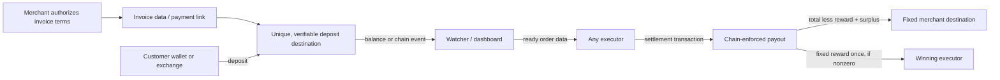
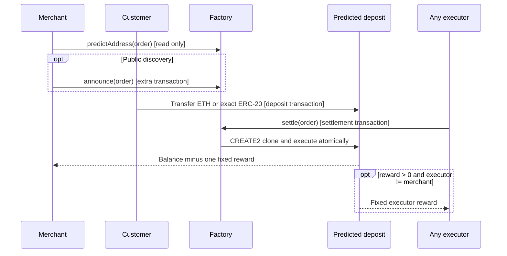
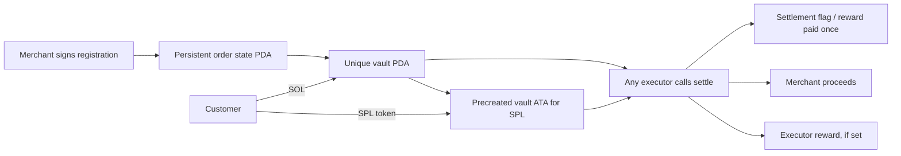

# Salute payment protocol architecture

**Status: 2026-10-05.** Ethereum/EVM, TRON TVM and Solana have local implementations and tests. TRON and Solana have not been validated on a public network. None has an independent security audit. This document records the shared product contract and where chain mechanics differ.

## Core promise

For each invoice, the merchant destination, asset, required total, order identity, and optional executor reward are fixed before the customer receives a deposit address. The customer funds that address. Anyone with the complete order terms and native network fees can submit settlement. Salute's dashboard, indexer, and executor are optional services; they cannot redirect the payment.



The deposit transaction cannot automatically invoke settlement on Ethereum, TRON, or Solana. A separate chain transaction is needed. A Salute-operated executor improves availability but is not privileged. Without a profitable or sponsored executor, funded orders may wait.

### Custody boundary

- Salute has **no deposit private keys** and no pooled customer wallet in this protocol.
- On EVM, the predicted receiver address and deployed clone bind the terms. On TRON, a TVM-specific CREATE2 receiver binds them in its creation code and immutable fields. On Solana, a program-derived vault has no private key; its registered merchant-signed state fixes the terms and the program pays only the merchant and, if set, the executor.
- A merchant wallet signs an on-chain announcement only if publication is selected on EVM. Private exported EVM order JSON is **not currently a signed intent**. The current Solana program requires the merchant signature for on-chain registration before funding.
- The local Solana deployment retains a developer upgrade authority to allow iteration. A public deployment must revoke that authority after review before describing its vault rules as immutable. The setup key cannot directly sign for a PDA, but upgrade authority is still a material trust power.
- The hosted interface, database, and RPC provider are still service dependencies for convenience. Token issuers and chain governance have their own powers. Do not describe the whole service as decentralized or production-audited.

## Chain flow

### Ethereum / EVM — implemented



The order is `(id, merchant, token, amount, executorFee)`. The chain, factory, implementation, and every order term determine the address. `amount` includes the reward. A zero reward means one merchant payout transfer; otherwise there are two payout transfers, except merchant self-execution combines them. All initial payouts and deployment revert together on failure. Surplus and late deposits belong to the merchant. A late sweep is another transaction and pays no second reward. The optional `announce` is public availability data and adds a transaction. [Implementation](../contracts/PaymentFactory.sol), [forwarder](../contracts/PaymentForwarder.sol).

### TRON — local TVM prototype

The TVM-specific factory predicts a CREATE2 receiver using the `0x41` hash domain; the receiver's immutable fields bind the merchant, token, amount, reward and ID. Any caller can settle after the deposit, and the first deployment and payout happen atomically. Zero reward makes one merchant transfer; a nonzero reward makes merchant and executor transfers. Local TRE tests pass for prefunded TRX and mock TRC-20, surplus, zero reward, changed terms and late sweeps. OpenZeppelin TRON Contracts' checked transfer helper handles TRON USDT's unusual return value, but **real USDT is not tested**. Public account activation, exact-token behavior, Energy/Bandwidth, address prediction and exchange withdrawal acceptance still require target-network validation. [Implementation](../tron/contracts/SaluteTron.sol), [local runbook](../tron/README.md), [TRON migration guide](https://developers.tron.network/docs/migrating-eth-contracts-to-tron).

### Solana — implemented local SOL and classic SPL prototype

Deploy one program. The merchant signs `register_sol` or `register_token` for an order ID. The program creates a persistent order-state PDA derived from merchant and ID, then a unique **vault PDA** derived from that state. The state records the immutable asset, amount, reward, merchant, vault rent reserve and settlement flag. An executor cannot choose a different recipient or enlarge the reward. The order state, vault, and token account are verified on every settlement.

For **SOL**, registration creates a System-owned vault PDA funded with a rent reserve. A customer then transfers SOL to it. Any executor submits `settle_sol`; the program pays all customer funds less the fixed reward to the merchant and pays the reward once. The reserve remains in the vault so small late deposits remain receivable. `sweep_late_sol` moves those later funds to the merchant without a second reward. The reserve and order-state rent are setup capital, not transaction fees. This implementation has **three on-chain transactions**: registration, deposit, settlement. A **two-transaction SOL variant is feasible but unimplemented**: derive the vault and settlement-state PDAs from a hash of every order term, transfer to the bare vault PDA, then initialize state and settle in one executor transaction. The local validator accepted a 1,000,000-lamport transfer to an uninitialized, System-owned vault PDA on 2026-10-05. The new instruction must preserve one-time reward and late-deposit handling, account for the minimum balance of an empty vault plus state rent, and decide whether a merchant signature is required for order authentication. Full-term address binding is essential if no on-chain merchant signature is checked.

For **SPL tokens**, `register_token` creates the vault's associated token account for one classic SPL mint before an ordinary exchange withdrawal. The customer sends to that unique ATA; any executor calls `settle_token`. This is also three transactions: registration, deposit, settlement. A self-custody payer can create the ATA and transfer tokens as two instructions in **one deposit transaction**, allowing a two-transaction order with a redesigned settle path. An exchange such as Binance may only transfer to an existing ATA, so practical exchange funding may still require a separate preparation transaction. Late tokens go only to the merchant. The token ATA remains open after settlement to receive late deposits; its rent remains funded. Token-2022 extensions need separate review.



**Exchange withdrawal limit:** PDAs are off-curve. Solana's address-verification guidance recommends explicit checks before an exchange sends to a smart-wallet address. There is no verified Binance commitment here that it will accept the vault PDA or create/use its ATA. Precreating the ATA removes one technical blocker but does not prove Binance compatibility. Test a small real withdrawal of the exact asset and network before advertising it. Do not substitute an on-curve private-key address merely to pass an exchange's form: that would reintroduce a key with power over deposits. [Solana PDAs](https://solana.com/docs/core/pda), [token accounts](https://solana.com/docs/tokens/basics/create-token-account), [address verification](https://solana.com/docs/payments/send-payments/verify-address).

## Observable status and service boundary

```text
draft → authorized/announced/prepared → awaiting deposit → partial → funded
      → settlement submitted → settled → merchant notified
```

The dashboard should show network, program/factory, immutable terms hash, deposit address, expected asset and amount, current verified balance, preparation/announcement transaction, each deposit transaction, settlement transaction, reward, merchant receipt, and any late sweep. A failed or replaced transaction must be shown as such. The local database is an index, never the source of authority over funds.

The current local portal has EVM order activity plus `/solana` and `/tron` pages. Solana's observer reads registered order PDAs, verified balances, and transaction history directly from the local validator. TRON's observer reads a local test-created order index, then rechecks balances, receiver state, and receipts against TRE. Both observers are read-only and bind to loopback; their demo indexes are not production services.

For a prototype, the portal can poll known addresses/accounts through RPC and offer manual settlement. For hosted invoices, use durable storage for order metadata and an indexer with historical backfill. A provider webhook is a hint: independently verify the actual chain, token, destination, amount, transaction outcome, and confirmation state before updating the invoice. Make merchant notifications idempotent and retryable. Publish or export enough order data for another executor to act if Salute is offline. [Solana verification](https://solana.com/docs/payments/accept-payments/verification-tools), [indexing](https://solana.com/docs/payments/accept-payments/indexing).

### Hosting the product

Vercel can host the portal, API routes, and a [custom domain](https://vercel.com/docs/domains/working-with-domains/add-a-domain). A durable order database, confirmed-chain reconciliation, and a separately operated permissionless executor are needed for unattended production invoices; [Vercel functions and cron jobs](https://vercel.com/docs/cron-jobs) do not provide a continuously running chain watcher. A practical deployment uses hosted Postgres, provider webhooks as wake-up signals, periodic backfill, and RPC verification before changing invoice status. The executor holds only a fee-paying key and obtains order terms from public announcements/registration or merchant-published data. It never holds a deposit key. Supply RPC URLs, factory/program IDs, token allowlists, database URL, and webhook verification secrets through the hosting provider's environment settings; keep executor credentials in its separate process. Local `.env.example` lists development variables and contains no real secrets.

## Required tests before calling a chain supported

- Distinct merchant, payer, and executor; zero and nonzero reward; exact, partial, and surplus funding.
- Terms/chain/program binding; direct-call and payout redirection rejection; repeat settlement; late deposits; failed transfers and callback/reentrancy behavior where applicable.
- Independent settlement using exported data with Salute services stopped.
- Native and target-token prefunding, exact address derivation, wallet and exchange deposit acceptance, account setup cost, and merchant receipt verified on the target network.
- Portal status for each step and failure. Use only local/devnet/testnet funds until chain-specific testing and independent security review are complete.
